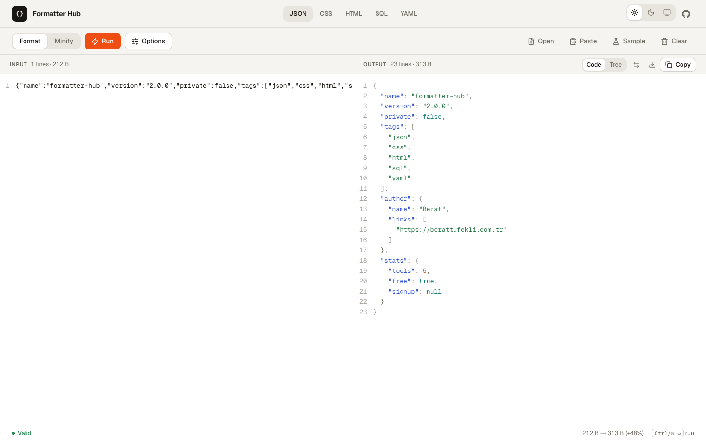
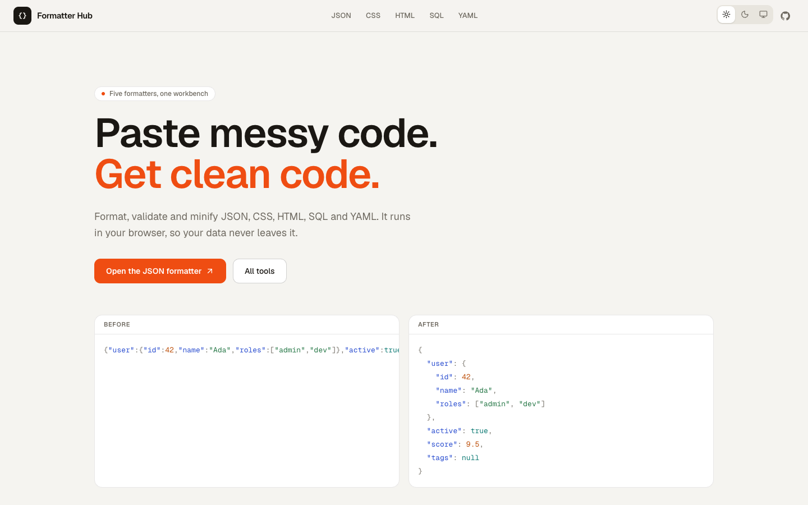
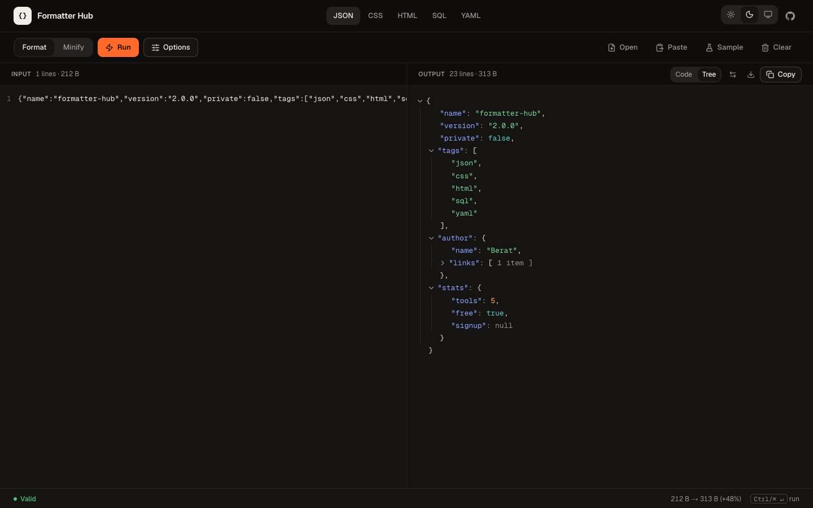
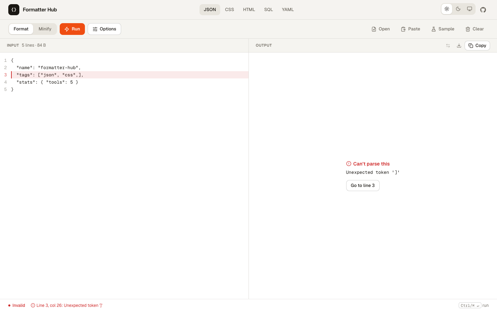
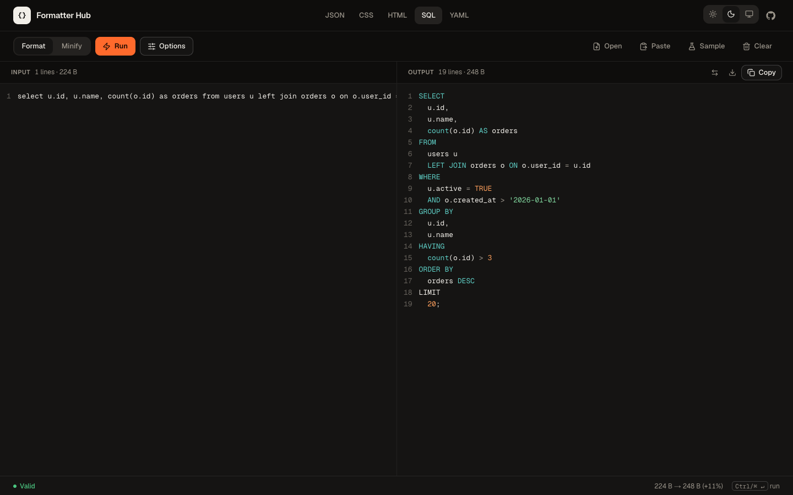

# Formatter Hub

Format, validate and minify **JSON, CSS, HTML, SQL and YAML** in the browser. Nothing is uploaded; everything runs on your device.



**Live:** https://formatterhub.vercel.app

## Tools

| Tool | Route | Actions |
|------|-------|---------|
| JSON | `/json` | Format, Minify, sort keys, collapsible tree view |
| CSS | `/css` | Format, Minify, sort properties |
| HTML | `/html` | Format, Minify |
| SQL | `/sql` | Format (keyword case option), Minify |
| YAML | `/yaml` | Format, convert to JSON |

## What it does

- One workbench for every tool: input on the left, output on the right, drag the divider to resize (or use the arrow keys)
- Formats as you type; turn it off in **Options** and run with `Ctrl/⌘ + Enter`
- Errors point at the exact line and column, mark the line in the editor, and *Go to line* jumps there
- Shortcuts: `Ctrl/⌘ + Enter` runs the main action, `Ctrl/⌘ + Shift + M` runs the second (Minify / To JSON)
- Open a file, drop one on the editor, paste from the clipboard, copy or download the result, or swap the output back into the input
- Indent with 2, 4, 8 spaces or tabs; line numbers, text size and font (Geist Mono, JetBrains Mono, Fira Code)
- Light, dark and system themes without a flash on load
- Your last input and settings are remembered in this browser only
- Phones get an Input / Output switch instead of two columns

## Stack

Next.js 16 (App Router), React 19, TypeScript, Tailwind CSS 4, Base UI (popover), Lucide.
Formatting uses [Prettier](https://prettier.io) (CSS, HTML, YAML), [sql-formatter](https://github.com/sql-formatter-org/sql-formatter) and the platform's `JSON`; [yaml](https://eemeli.org/yaml/) converts YAML to JSON and [highlight.js](https://highlightjs.org) colours the output. Formatters load on demand, so each page only fetches the one it needs.

## Structure

```
src/
├── app/                      # routes: /, /json, /css, /html, /sql, /yaml
├── components/
│   ├── site-header.tsx
│   ├── theme-toggle.tsx
│   └── workbench/            # workbench, code panes, JSON tree, options popover
├── lib/
│   ├── tools.ts              # the five tools: samples, actions, labels
│   ├── highlight.ts
│   └── formatters/           # one pure module per language + unit tests
tests/e2e/                    # Playwright end-to-end tests
```

## Scripts

```bash
npm install
npm run dev        # http://localhost:3000
npm run build
npm run lint
npm test           # unit tests for the formatters (Vitest)
npm run test:e2e   # Playwright; builds and serves the app on port 3100, uses installed Chrome
```

## Screenshots

| | |
|---|---|
|  |  |
|  |  |

## License

MIT
